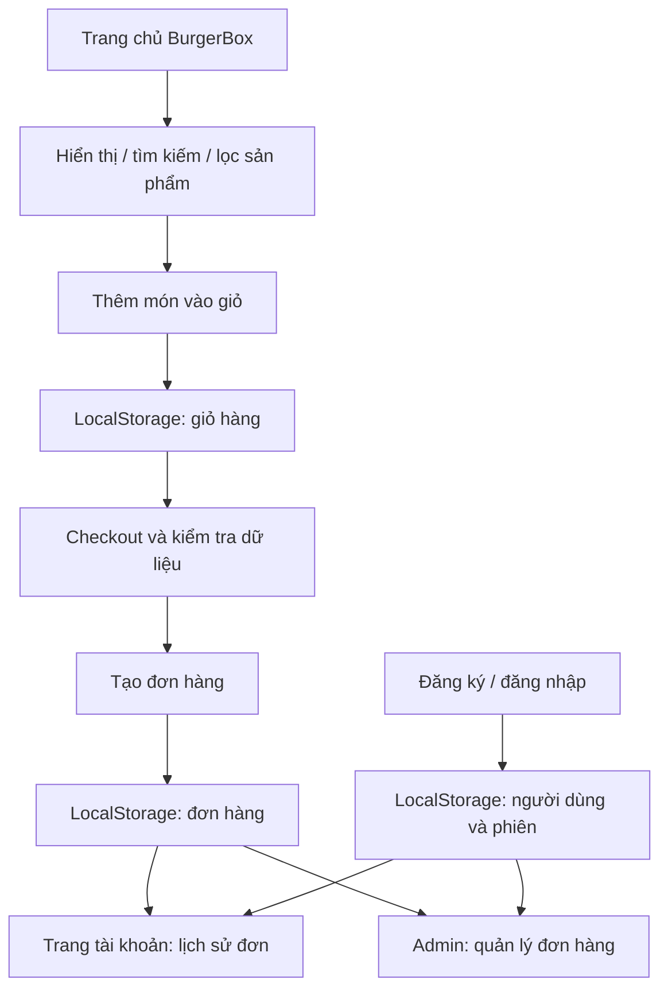

# BÁO CÁO Y3 – BURGERBOX

## 1. Giới thiệu đề tài
BurgerBox là website bán đồ ăn nhanh được xây dựng bằng HTML5, CSS3 và Vanilla JavaScript. Website mô phỏng một quy trình bán hàng hoàn chỉnh gồm khách hàng, giỏ hàng, đặt hàng, tài khoản và khu vực quản trị.

## 2. Phạm vi theo ASM
- Hiển thị sản phẩm bằng mảng đối tượng JavaScript.
- Phân nhóm sản phẩm: Mới, Bán chạy, Khuyến mãi.
- Slider/banner có nút Previous, Next và Dot.
- Form liên hệ có kiểm tra dữ liệu bắt buộc, email và số điện thoại.
- Giỏ hàng: thêm, xóa, tăng/giảm số lượng, tính tiền và lưu LocalStorage.
- Countdown Clock bằng JavaScript.
- Tổ chức mã nguồn JS trong thư mục `js`, CSS trong `css`, HTML ở cấp dự án.
- Có thêm các yêu cầu tự đề xuất để mở rộng trải nghiệm.

## 3. Các chức năng mở rộng
### Khách hàng
- Đăng ký và đăng nhập.
- Ghi nhớ phiên đăng nhập bằng LocalStorage.
- Trang tài khoản cá nhân.
- Xem lịch sử đơn hàng.
- Xem chi tiết đơn hàng.
- Hủy đơn khi đơn còn ở trạng thái `Chờ xác nhận`.
- Đặt lại đơn hàng.
- Yêu thích sản phẩm.
- Tìm kiếm, lọc danh mục và sắp xếp sản phẩm.
- Mã giảm giá.
- Phí giao hàng và tổng tiền checkout.

### Quản trị viên
- Dashboard tổng quan.
- Quản lý sản phẩm: thêm, sửa, xóa, tìm kiếm, lọc nhóm và tồn kho.
- Quản lý danh mục: thêm, đổi tên, xóa.
- Quản lý đơn hàng và cập nhật trạng thái.
- Xem chi tiết đơn hàng.
- Xuất dữ liệu đơn hàng CSV.
- Quản lý khách hàng và khóa/mở khóa tài khoản.
- Quản lý mã giảm giá.
- Quản lý đánh giá.
- Cài đặt tên cửa hàng, phí giao hàng và trạng thái cửa hàng.

## 4. Phân tích một số hàm JavaScript chính
| Chức năng | Hàm/Module | Vai trò |
|---|---|---|
| Dữ liệu sản phẩm | `js/data.js` | Khai báo mảng đối tượng sản phẩm và tiện ích định dạng tiền |
| Slider | `js/slider.js` | Chuyển slide, Previous/Next/Dot |
| Hiển thị menu | `js/app.js` | Render, tìm kiếm, lọc, sắp xếp, yêu thích, xem nhanh |
| Giỏ hàng | `js/cart.js` | CRUD giỏ hàng, LocalStorage, checkout |
| Xác thực | `js/auth.js` | Đăng ký, đăng nhập, session, phân quyền |
| Tài khoản | `account.html` | Lịch sử, chi tiết, hủy và đặt lại đơn |
| Quản trị | `js/admin.js` | Dashboard và toàn bộ module quản trị |
| Form | `js/form.js` | Kiểm tra dữ liệu form liên hệ |

## 5. Cấu trúc giao diện
Website sử dụng bố cục responsive gồm header, navigation, hero slider, flash sale, menu sản phẩm, combo, benefits, contact form và footer. Các modal được dùng cho giỏ hàng, chi tiết sản phẩm, checkout và chi tiết đơn hàng.

## 6. Công nghệ và công cụ
- HTML5
- CSS3
- Vanilla JavaScript
- LocalStorage API
- Intl.NumberFormat
- Google Fonts
- GitHub để quản lý mã nguồn

Không sử dụng framework JavaScript để giữ đúng định hướng bài ASM cơ sở JavaScript.

## 7. Dữ liệu và lưu trữ
Dữ liệu demo được lưu ở LocalStorage với các key chính:
- `burgerbox-products`
- `burgerbox-cart`
- `burgerbox-users`
- `burgerbox-session`
- `burgerbox-orders`
- `burgerbox-categories`
- `burgerbox-coupons`
- `burgerbox-reviews`
- `burgerbox-settings`

## 8. Tài khoản demo
**Admin**
- Email: `admin@burgerbox.local`
- Mật khẩu: `admin123`

**Customer**
- Email: `user@burgerbox.local`
- Mật khẩu: `123456`

## 9. Lưu ý bảo mật
Đây là dự án frontend phục vụ học tập/ASM. Tài khoản và session được mô phỏng bằng LocalStorage, vì vậy cơ chế này không phù hợp để triển khai production. Một hệ thống thực tế cần backend, cơ sở dữ liệu, mật khẩu được hash, session/token an toàn và kiểm soát quyền phía server.

## 10. Kịch bản demo đề xuất
1. Mở `index.html`.
2. Tìm kiếm và lọc sản phẩm.
3. Thêm món vào giỏ, tăng/giảm số lượng.
4. Mở checkout và áp dụng `SALE10` hoặc `BURGER20`.
5. Hoàn tất đơn hàng.
6. Đăng nhập Customer để xem đơn, mở chi tiết và thử đặt lại/hủy nếu trạng thái cho phép.
7. Đăng nhập Admin.
8. Kiểm tra Dashboard.
9. Vào Sản phẩm để sửa tồn kho.
10. Vào Đơn hàng để cập nhật trạng thái.
11. Kiểm tra Khách hàng, Mã giảm giá, Đánh giá và Cài đặt.
12. Xuất CSV đơn hàng.

## 11. Kết luận
BurgerBox đáp ứng các yêu cầu cốt lõi của ASM Lập trình cơ sở với JavaScript và mở rộng thành một mô hình website bán đồ ăn nhanh có luồng khách hàng – đơn hàng – quản trị tương đối hoàn chỉnh. Các chức năng mở rộng được tách khỏi nhóm yêu cầu bắt buộc để thuận tiện trình bày khi bảo vệ bài.

## 12. Sơ đồ luồng chức năng

## 13. Ba chức năng tự đề xuất và lý do

1. **Tìm kiếm, lọc và sắp xếp sản phẩm:** giảm thời gian tìm món, cho phép so sánh theo giá và danh mục.
2. **Danh sách yêu thích:** giúp người dùng lưu món muốn xem lại; trạng thái được lưu trong LocalStorage.
3. **Quick View và checkout có mã giảm giá:** rút ngắn thao tác xem thông tin và mô phỏng quy trình đặt món gần với cửa hàng thực tế.

Các chức năng trên là lựa chọn trình bày dựa trên mã nguồn hiện có; khi bảo vệ cần chạy demo và chỉ ra file xử lý tương ứng.

## 14. Kết quả kiểm tra mã nguồn

- Đã sửa truy cập trường form đăng ký sang `document.getElementById`.
- Đã bổ sung hiển thị lỗi động cho form liên hệ và CSS tương ứng.
- Đã sửa điều kiện bộ lọc tồn kho Admin.
- Kiểm tra cú pháp thành công cho các file JavaScript chính và script inline đăng ký.
- Chưa thực hiện kiểm thử end-to-end trong trình duyệt; cần hoàn thành checklist thủ công trước khi xác nhận toàn bộ website đạt.

## 15. Thông tin sinh viên

- Họ và tên: **[Điền họ tên sinh viên]**
- Mã sinh viên: **[Điền mã sinh viên]**
- Lớp: **[Điền lớp]**
- Môn học: **Lập trình cơ sở với JavaScript**
- Đề tài: **BurgerBox — Website bán đồ ăn nhanh**

### Bổ sung kết quả kiểm thử logic

Ngoài kiểm tra cú pháp, đã chạy kiểm thử logic cô lập với DOM và LocalStorage giả lập:
- Form liên hệ: bỏ trống họ tên và email sai đều hiển thị lỗi; dữ liệu hợp lệ hiển thị thông báo thành công.
- Đăng ký/đăng nhập: đăng ký mới, từ chối email trùng, đăng nhập đúng, từ chối mật khẩu sai và từ chối tài khoản bị khóa.
- Bộ lọc tồn kho: xác minh các trường hợp all/low/out với mức tồn kho 20, 5, 1 và 0.

Các ca trên PASS. Kiểm thử giao diện end-to-end trong trình duyệt thật vẫn chưa chạy; không coi đó là kết quả PASS.
